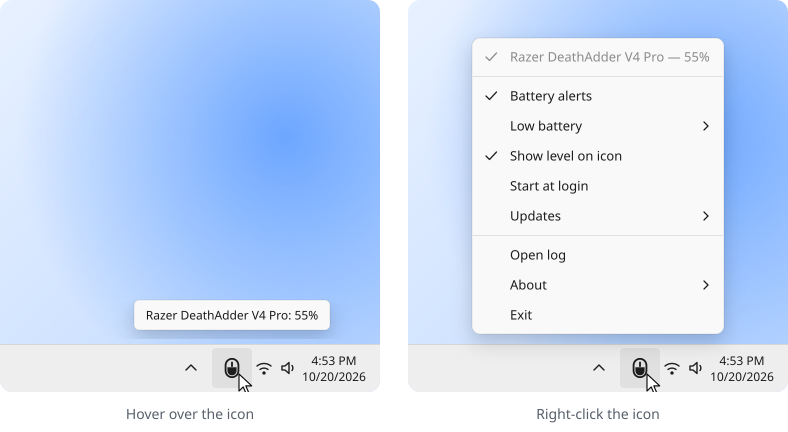

<div align="center">

# Razer Battery Report

Shows the battery level of your wireless Razer mouse in the Windows system tray.

[](https://github.com/xzeldon/razer-battery-report/releases/latest)
[](https://github.com/xzeldon/razer-battery-report/releases)
[](LICENSE)

<picture>
  <source media="(prefers-color-scheme: dark)" srcset="docs/tray-dark.svg">
  
</picture>

</div>

> [!TIP]
> The app reads the battery level directly from the mouse. You do not need Razer Synapse.

> [!NOTE]
> The app works only on Windows at this time. Linux and macOS support is planned.

## The tray icon

The icon is a mouse. The fill of the mouse shows the battery level. To see the exact
percentage, put the pointer on the icon.

| Icon | Meaning |
| --- | --- |
| White or black mouse | The battery level is normal. The color follows the Windows theme. |
| Yellow mouse | The battery level is low. You set this level in the menu. The default is 15%. |
| Red mouse | The battery level is 5% or less. |
| Mouse with a lightning bolt | The mouse is charging. |
| Mouse with a moon | The mouse is asleep and does not send data. |
| Crossed-out mouse | No supported mouse is connected. |

## Install

1. Download the file that ends in `-setup.exe` from the
   [latest release](https://github.com/xzeldon/razer-battery-report/releases/latest).
2. Run the file. The app installs for your Windows user only. It does not ask for administrator
   rights.
3. If Windows hides the icon, drag the icon from the overflow area to the taskbar.
4. To start the app with Windows, right-click the icon and select **Start at login**.

**Portable version.** The release also has a portable exe, without an installer. Put the exe in a
folder and run it. The portable version has the same functions and also updates itself.

**Requirements.** Windows 10 or Windows 11, 64-bit. Use Windows 11 24H2 or later if possible. On
older versions, a console window opens for a moment each time the app starts.

## Tray menu

Right-click the icon to open the menu.

| Item | What it does |
| --- | --- |
| Your mice | Shows each connected mouse and its battery level. If more than one mouse is connected, select the mouse that the icon shows. |
| **Battery alerts** | Turns notifications on or off. A notification shows when a mouse connects or disconnects, when the battery is low, when it is at 5% or less, and when charging is complete. |
| **Low battery** | Sets the low battery level: 10, 15, 20 or 25%. At this level the icon becomes yellow and a notification shows. |
| **Show level on icon** | Turn it off to show only the outline of the mouse, without the fill. |
| **Start at login** | Starts the app when you log in to Windows. |
| **Updates** | Sets what the app does when a new version is available. See [Updates](#updates). |
| **Open log** | Opens the log file. Attach this file when you report a bug. |
| **About** | Shows the version. Has links to this page and to the licenses of the libraries in the app. |
| **Exit** | Stops the app. |

## Updates

The app checks GitHub for a new version one time each day. Select a mode in the **Updates** menu:

- **Notify only** is the default. The app shows a notification and adds **Update to vX.Y.Z** to
  the menu. Select this item to install the update.
- **Install automatically** installs the update without a question.
- **Off** stops the daily check.

**Check now** checks immediately, in all modes.

## Uninstall

### Installed version

1. Open **Settings > Apps > Installed apps**.
2. Find **Razer Battery Report**. Select **...**, then **Uninstall**.
3. The uninstaller asks: "Also delete your settings and logs?"
   - Select **Yes** to remove the app completely.
   - Select **No** to keep your settings for a later installation.

### Portable version

1. Right-click the tray icon and select **Exit**.
2. Open a terminal in the folder of the exe.
3. Run the exe with `cleanup --all`. Use the name of your file, for example:

   ```console
   > .\razer-battery-report-v1.0.0-x86_64-pc-windows-msvc.exe cleanup --all
   ```

4. Delete the exe.

To keep your settings and logs, run `cleanup` without `--all`.

### What the app stores

A complete removal deletes all of these items. Nothing else stays on your computer.

| Location | Contents |
| --- | --- |
| `%APPDATA%\razer-battery-report\config.toml` | Your settings. |
| `%LOCALAPPDATA%\razer-battery-report\` | Logs, downloaded updates and small files that the app needs to run. |
| `%LOCALAPPDATA%\Programs\Razer Battery Report\` | The installed app and its uninstaller. Only the installer creates this folder. |
| Start menu shortcut **Razer Battery Report** | Only the installer creates this shortcut. |
| Registry value `Razer Battery Report` in `HKCU\Software\Microsoft\Windows\CurrentVersion\Run` | The **Start at login** entry. |
| Registry key `HKCU\Software\Classes\AppUserModelId\xzeldon.RazerBatteryReport` | The name and icon of the notifications. |

## Command line

The same exe also works in a terminal. Open the terminal in the folder of the exe. The installer
puts the exe in `%LOCALAPPDATA%\Programs\Razer Battery Report`.

```console
> .\razer-battery-report.exe status
Razer DeathAdder V4 Pro  42%
```

| Command | What it does |
| --- | --- |
| `status` | Prints the battery level of each connected mouse. |
| `status --json` | Prints the same data as JSON, with the serial number and the connection of each mouse. |
| `diagnose` | Prints a report with the app version, the file locations and all mice that the app finds. Add this report to bug reports. |
| `cleanup` | Removes all files and registry entries of the app, but keeps your settings and logs. |
| `cleanup --all` | Removes all files and registry entries of the app, including your settings and logs. |

## Supported mice

Each connection of a mouse has its own USB product ID. The table shows these IDs. The vendor ID
of Razer is 1532. If you connect one mouse with the cable and the receiver at the same time, the
app shows it one time.

| Mouse | Cable | Receiver | Bluetooth |
| --- | --- | --- | --- |
| Razer Atheris ¹ |  | 0062 |  |
| Razer Basilisk Mobile ¹ | 00D3 | 00D4 |  |
| Razer Basilisk Ultimate | 0086 | 0088 |  |
| Razer Basilisk V3 Pro | 00AA | 00AB |  |
| Razer Basilisk V3 Pro 35K | 00CC | 00CD |  |
| Razer Basilisk V3 Pro 35K Phantom Green Edition | 00D6 | 00D7 |  |
| Razer Basilisk V3 X HyperSpeed ¹ |  | 00B9 |  |
| Razer Basilisk X HyperSpeed ¹ |  | 0083 |  |
| Razer Cobra HyperSpeed | 00DA | 00DB |  |
| Razer Cobra Pro | 00AF | 00B0 |  |
| Razer DeathAdder V2 Pro | 007C | 007D |  |
| Razer DeathAdder V2 X HyperSpeed ¹ |  | 009C |  |
| Razer DeathAdder V3 HyperSpeed | 00C4 | 00C5 |  |
| Razer DeathAdder V3 Pro | 00B6, 00C2 | 00B7, 00C3 |  |
| Razer DeathAdder V4 Pro | 00BE | 00BF |  |
| Razer HyperPolling Wireless Dongle |  | 00B3 |  |
| Razer Lancehead | 0059 | 005A |  |
| Razer Lancehead Wireless | 0070 | 006F |  |
| Razer Mamba 2012 | 0024 | 0025 |  |
| Razer Mamba Chroma | 0044 | 0045 |  |
| Razer Mamba Wireless | 0073 | 0072 |  |
| Razer Naga Epic | 001F |  |  |
| Razer Naga Epic Chroma | 003E | 003F |  |
| Razer Naga Pro | 008F | 0090 |  |
| Razer Naga V2 HyperSpeed ¹ |  | 00B4 |  |
| Razer Naga V2 Pro | 00A7 | 00A8 |  |
| Razer Orochi V2 ¹ |  | 0094 | 0095 |
| Razer Ouroboros | 0032 |  |  |
| Razer Pro Click | 0080 | 0077 |  |
| Razer Pro Click Mini |  | 009A |  |
| Razer Pro Click V2 | 00D0 | 00D1 |  |
| Razer Pro Click V2 Vertical Edition | 00C7 | 00C8 |  |
| Razer Viper Mini SE | 009E | 009F |  |
| Razer Viper Ultimate | 007A | 007B |  |
| Razer Viper V2 Pro | 00A5 | 00A6 |  |
| Razer Viper V3 HyperSpeed ¹ |  | 00B8 |  |
| Razer Viper V3 Pro | 00C0 | 00C1 |  |
| Razer Viper V3 Pro SE | 00DE | 00DF |  |
| Razer Viper V4 Pro | 00E5 | 00E6 |  |

¹ This mouse does not report if it is charging. For this mouse, the app does not show the
lightning bolt or the "fully charged" notification.

The list comes from [openrazer](https://github.com/openrazer/openrazer). If your mouse is not in
the list, see [Adding a mouse](CONTRIBUTING.md#adding-a-mouse).

## Questions

<details>
<summary><b>The mouse is connected, but the icon shows a moon.</b></summary>
<br>

The mouse is asleep and does not answer. Move the mouse. The battery level comes back after a
few seconds.

</details>

<details>
<summary><b>The icon shows a crossed-out mouse.</b></summary>
<br>

The app does not find a supported mouse. Do these steps:

1. Make sure that the mouse is in the [list of supported mice](#supported-mice).
2. Connect the receiver or the cable again.
3. If the problem continues, right-click the icon and select **Open log**. Attach the log file
   to a [bug report](https://github.com/xzeldon/razer-battery-report/issues).

</details>

<details>
<summary><b>My mouse uses rechargeable AA batteries, and the percentage is wrong.</b></summary>
<br>

The mouse calculates the percentage itself, for alkaline batteries. NiMH batteries have a lower
and flatter voltage. Thus the level drops quickly at first and then stays the same for a long
time. The app shows the value that the mouse sends.

</details>

<details>
<summary><b>Windows installed a Razer driver when I connected the mouse.</b></summary>
<br>

Windows Update installs this driver, not this app. The app does not need the Razer driver or
Razer Synapse.

</details>

## Build from source

See [CONTRIBUTING.md](CONTRIBUTING.md). Package maintainers can build with
`--no-default-features`. This removes the update check, so that the package manager controls
updates.

## Credits

- [openrazer](https://github.com/openrazer/openrazer) for the protocol and the device data.
- [Lucide](https://lucide.dev) for the icons, used under the ISC license
  ([`assets/icons/lucide/LICENSE`](assets/icons/lucide/LICENSE)).
- [razer-battery-checker](https://github.com/spozer/razer-battery-checker), a Python script that
  reads the same battery data.
- [elem](https://github.com/Fuwn/elem), a battery tray icon for Logitech mice.

## License

MIT. See [LICENSE](LICENSE).
